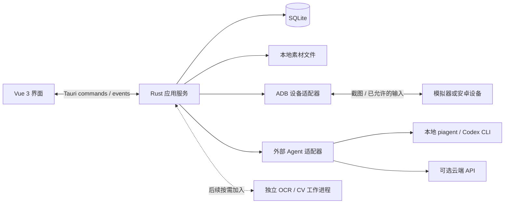

# 系统架构

## 状态与技术建议

本文区分目标架构与当前实现：Vue/Tauri 骨架、独立 Rust 核心、demo 适配器和类型化 IPC 已建立；ADB、数据库、OCR 与真实 Agent 尚未接入。当前目录与启动方式见 [开发文档](development.md)。GUI 按 Tauri 2 + Vue 3 + TypeScript 设计；Rust 负责桌面宿主、设备操作与数据库。目标平台已确认为 Windows/macOS，连接 MuMu 国服。Agent 接入已有 piagent/Codex，不内建 Agent 框架；首版只给建议。最简实现建议先由 Rust 宿主通过受管理子进程调用已有 Agent CLI，把截图和上下文交给它分析。需要专用 OCR/CV 时再加入独立 Python 识别进程，避免首版额外打包运行时。云端 API 可作为可选适配器，具体提供方未定。

## 模块与数据流



- UI：展示、表单与交互状态，不直接运行 shell、访问数据库或连接模型。
- Rust 应用服务：用例编排、校验、任务管理、数据库事务、素材存储。
- 设备适配器：设备枚举、截图、连接健康与输入；所有请求绑定设备序列号。
- 识别模块：从带元数据的截图提取候选字段，不直接写正式档案。
- Agent 适配器：接收结构化状态与必要图像，返回建议及依据。
- 执行模块：如果后续启用，只接受受约束的动作对象，不执行 Agent 返回的任意 shell。
- SQLite：由宿主单点写入；工作进程通过结果消息返回数据，避免跨语言重复承担持久化职责。

## 当前目录与职责

```text
apps/desktop/src/
  app/                 组合入口与依赖注入
  features/            功能组件与页面状态
  infrastructure/      Tauri IPC / 浏览器演示适配器
  shared/              通用展示能力
apps/desktop/src-tauri/src/  Rust 组合入口和薄命令层
crates/fgo-core/src/
  domain/              领域模型与规则
  application/         用例编排与输入校验
  ports.rs             外部能力接口
crates/fgo-adapters/    具体适配器（当前 demo）
packages/contracts/    前端类型与运行时 Schema
services/recognition/  可选独立识别服务预留
resources/            名称资料与布局配置预留
database/migrations/  数据库迁移预留
tests/fixtures/       共享演示与后续回放样本
docs/                 设计和开发文档
```

核心依赖 domain/ports，适配器实现 ports，Tauri 宿主组装两者；功能页面只调用注入的 DesktopGateway。当前 IPC 仅 load_workspace 与 search_names，协议版本为 1；后文采集/执行接口为后续设计，尚未实现。

## 通信协议

内部适配器统一输入截图引用、任务类型、结构化上下文与输出 Schema。外部 CLI 按其已验证的非交互调用方式启动，捕获结果并校验；不能假定 piagent 与 Codex 支持相同参数或相同流协议。避免 shell 拼接，使用程序路径与参数数组。先检查版本、图像输入、结构化输出、超时取消和认证方式，再确定首个适配器；无法满足时明确报告能力缺失。

以下逐行 JSON 协议仅用于项目自有的可选 OCR/CV 工作进程：stdin/stdout 传递协议，stderr 输出日志，不开放本地 HTTP 端口。已有 Agent 的原生 CLI/API 响应由适配器转换为内部协议。

请求包含 protocol_version、request_id、method、deadline 和 params；响应回传 request_id、result 或结构化 error。耗时任务用 job_id 上报进度，支持 cancel。启动握手返回协议版本和能力列表；不兼容时明确失败。

建议初期方法：health、recognize_servant、analyze_battle；执行接口在范围确定后再定义。大图像以宿主管理的数据目录内文件引用传递，限制路径范围并校验存在性。结果携带 frame_id、captured_at、字段来源、识别器版本与置信度。识别置信度由识别链路提供，不能简单采用模型自称的概率。

UI 与宿主使用小粒度 commands，如 list_devices、capture_frame、start_recognition、confirm_import、save_team、analyze_battle；事件负责进度和设备状态。错误区分设备不可用、页面不支持、识别不完整、模型不可用、协议不兼容与存储失败。

## 采集链路

1. ADB 选定设备，读取截图尺寸与方向，建立 frame_id。
2. 布局配置定位有效游戏区域，保留原图到规范化图的坐标变换。
3. 页面分类后按区域 OCR/视觉模型识别名字与培养字段；头像和立绘只裁剪，不做身份模板匹配。不支持的页面停止当前识别。
4. 规范化识别出的名称文本，检索官方中／日名称表；模糊命中和同名多条返回候选供用户校准。没有可读名字时提示打开详情页或手动关联，不凭图猜身份。名称不是持有实例唯一标识，流程见 [名称校准与识别评估](recognition-evaluation.md)。
5. 跨页聚合时检查从者身份与会话连续性；无法确认则等待校对。
6. 展示与已有记录的差异；用户确认后事务更新字段与素材引用。

扫描任务状态建议为 pending → running → awaiting_review → completed；可进入 failed/cancelled。确认写入使用幂等键，重试不能重复创建同一确认结果。

## 可选自动翻页

先验证目标 MuMu 版本中的页面识别、翻页按钮/手势与画面稳定判断。如果可复用 ADB 输入和已有布局配置，且无需通用导航规划器，可作为小型增强实现。每步执行后验证目标页，保留页面指纹防止重复和循环，设置最大步数，支持取消；无变化、意外页面或断连时停止并交还手动操作。跨从者身份仍须校验，不能根据翻页成功就自动合并。当前尚无设备验证，不能断言成本很低。

## 编队校验服务

在 Rust 应用层统一计算礼装实例占用、账号归属、助战约束和 COST。前端编辑时调用同一校验逻辑，保存草稿时保留问题但拒绝损坏引用的数据。官方资料仅用于中／日名称校准，不包含费用或技能规则。费用与上限先从游戏可见信息识别/由玩家手工确认，独立记录来源；后续若接入规则表需另行确定范围，未知不默认为 0。返回逐槽位明细、总额、上限、规则版本和 passed/exceeded/unknown 状态，UI 不重复实现一套算法。普通规则中助战及其概念礼装不计费，御主礼装不计费；特殊关卡用显式覆盖规则。Agent 上下文可附队伍和礼装配置，但需区分计划编队与当前战斗实际配置。

## 外部 Agent 适配器

统一接口建议为 probe_capabilities 与 analyze(task, frames, context, output_schema)。首个适配器优先选择用户已安装且支持非交互图像输入的 CLI，另预留 DirectApiAdapter；本轮不虚构具体调用命令。

输出统一为结构化状态、建议步骤、依据和 unknowns；外部返回自由文本或不合法 JSON 时不直接写档案，展示解析失败及可重试入口。Agent 工作目录使用隔离的任务目录，只提供必要截图与上下文；有工具权限配置时关闭与分析无关的文件修改、shell 和设备输入能力。复用用户已有认证，不读取或复制其凭据文件。直接云端调用时明确展示当前提供方，截图只在用户启用的适配器任务中发送。

## 战况与执行边界

单次状态快照不等于完整游戏状态。BattleSnapshot 保存可观察值与 unknown；历史推断另标记来源。建议绑定快照，包含 prerequisites、steps、rationale 和 unknowns。

建议生成与执行分开。采集采用手动切页后识别，自动翻页在低成本且可靠时作为可选增强。首版战斗不启用输入能力。若未来单独增加输入能力，每台设备串行化截图导航/执行任务，避免采集与战斗同时点击。动作包含预期页面和坐标变换；执行前重新验证设备、画面与状态，执行后截图确认。状态改变或取消后停止后续动作。tap 不盲目重试，先观察其是否已经生效。

## 持久化与运行时

SQLite 建议启用外键与有序迁移。数据库放系统应用数据目录；截图、裁剪和日志放对应子目录，不放源码仓库。素材按哈希命名，通过元数据引用；写入先落临时文件并原子改名，数据库提交失败的孤立素材可后续清理，引用中的素材不可删除。

数据库与素材备份需要同一清单/一致快照，导出功能的首版范围待确认。采集截图保留策略可配置，清理不得破坏仍被校对任务引用的证据。

主进程负责工作进程启动、健康检查、超时、取消和退出回收。重启后恢复为待重试状态，不自动续发设备输入。日志记录任务 ID 与错误类型，避免写模型密钥或完整敏感配置。

## 验证与待验证风险

- 用代表性截图建立字段级识别评估和页面分类样本，区分缺失、误识别与身份错配。
- 用同名多份持有、人工修正后重扫、跨页切错从者验证数据合并。
- 用设备断连、超时与取消验证任务恢复及持久化边界。
- 用数据库重启和迁移验证本地数据保留。
- 用真实目标系统验证 Tauri 安装包、ADB 发现、工作进程打包与权限。
- 识别效果、桌面系统兼容性与模型资源占用尚未实测；云环境不能替代用户设备联调。
